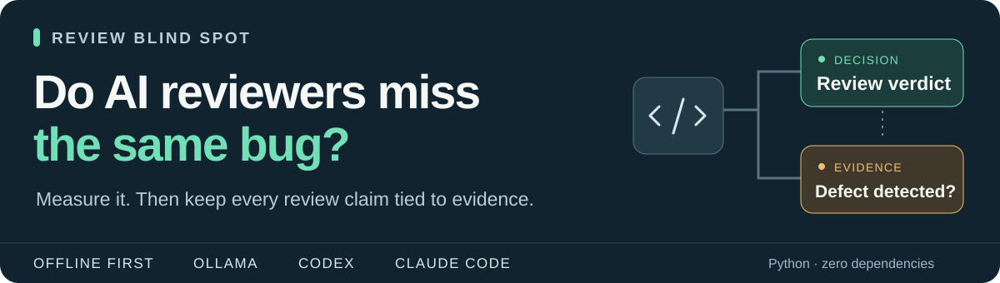
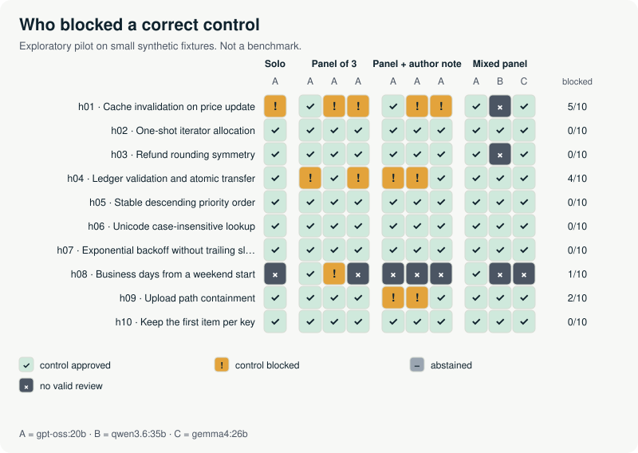

# Review Blind Spot

<p><picture>
  <source media="(max-width: 600px)" srcset="docs/assets/overview-compact.svg">
  
</picture></p>

[](https://github.com/Venorium/review-blindspot/actions/workflows/tests.yml)
[](LICENSE)


[](docs/CODEX.md)

**Adding AI reviewers only helps if they fail differently.** Review Blind Spot measures
whether they do: same code change, same written contract, paired correct and faulty
versions, and an outcome model that never counts "blocked for the wrong reason" as
"found the bug". It also ships an Agent Skill that makes your own Codex or Claude Code
reviews show their evidence, their gaps and when they went stale.

**[Pilot results](#pilot-results-500-local-reviews-three-open-models)** · **[Use it in your agent](#use-it-in-codex-or-claude-code)** · **[Measure your own reviewers](#measure-your-own-reviewers)** · [Protocol](research/PROTOCOL.md) · [What is verified](docs/VALIDATION.md)

## Pilot results: 500 local reviews, three open models

gpt-oss:20b, qwen3.6:35b and gemma4:26b reviewed 25 paired changes through Ollama, free and
offline, in four protocols: one reviewer, a panel of three samples of one model, the same
panel shown the author's note, and a mixed panel of three model families. Each plan was
frozen before its first request; every request, raw answer and judgment is published.

**They never missed a planted bug.** In 250 reviews of faulty changes, every one was
blocked with a finding that names the planted defect, across every model and protocol,
on the 15 development cases and on 10 harder ones (omissions, effects across functions,
one-shot iterators, signed rounding, Unicode, retries, path containment).

**The shared blind spot ran the other way.** On correct code, independent samples of one
model invented the same unwritten requirements, so blocking on any single objection made
panels reject more correct changes than one reviewer did: 3 of 10 for the panel of three
against 1 of 10 for the solo reviewer, at three times the output tokens.

<a href="results/pilot-2026-11-10-v2/README.md"></a>

| Pilot | Reviews | Faulty changes approved | Defect identified | Correct changes blocked |
| --- | --- | --- | --- | --- |
| [A: 15 development cases](results/pilot-2026-11-10/README.md) | 300 | 0 of 150 reviews | 150 of 150 | 0 of 150 reviews |
| [B: 10 harder cases](results/pilot-2026-11-10-v2/README.md) | 200 | 0 of 100 reviews | 100 of 100 | 12 of 91 valid reviews |

Exploratory and small: 25 synthetic families, mid-size open models on one machine, judged
by the LLM agent that wrote corpus v2 and knew the targets. These are counts to inspect,
not model rankings. Pilot B also shows why "blocked" and "found the bug" stay separate:
18 of its 100 correct detections came with a flawed worked example.

## Use it in Codex or Claude Code

Install it as a plugin straight from GitHub (Python 3.11+ and Git required):

| Agent | Install |
| --- | --- |
| Codex | `codex plugin marketplace add Venorium/review-blindspot` then `codex plugin add review-blindspot@review-blindspot` |
| Claude Code | `/plugin marketplace add Venorium/review-blindspot` then `/plugin install review-blindspot@review-blindspot` |
| One project only | `python tools/install_codex_skill.py --project /path/to/project --host all` from a clone |

Then ask for a review before you commit: `$review-blindspot Review my changes` in Codex,
`/review-blindspot` in Claude Code. The skill captures your Git changes, has the agent
record each claim with its evidence, and checks the record before it answers:

| The helper sees | You get |
| --- | --- |
| A changed file or a claim with no evidence | **incomplete**, with the gap named |
| A claim the agent recorded as contradicted | **attention required**, with the counterexample |
| Code changed after the review began | **stale**: the conclusion no longer applies |
| Every recorded claim supported, nothing missing | **documented**, which is still not an approval |

No MCP server, API key or extra model call: four self-contained files in the open
[Agent Skills](https://agentskills.io) format, installed per project without overwriting
anything. `python tools/demo_codex_skill.py` shows the three states without any model.
[Guide](docs/CODEX.md) · [Example report](docs/examples/codex/REPORT.md) · [Skill source](skills/review-blindspot/SKILL.md)

## Measure your own reviewers

```bash
python -m rbs quickstart                     # 16 scripted reviews, no model, a few seconds
python -m rbs prepare --config configs/smoke.json --run runs/my-run --packets ../my-run-packets
python -m rbs review  --run runs/my-run --transport configs/transport.ollama-pilot.json   # dry run
python -m rbs review  --run runs/my-run --transport configs/transport.ollama-pilot.json --confirm-jobs 16
python -m rbs status  --run runs/my-run      # what is missing, failed or awaiting judgment
```

`rbs review` sends each job as one fresh request to a local or remote **Ollama** model
(text only, no tools, output cap enforced) or to **any command** that reads the prompt on
stdin, such as `codex exec`. Nothing is sent until `--confirm-jobs` matches the exact
number of reviews. Model digests are frozen before the first request, raw requests and
responses are kept with their hashes, and failures stay recorded instead of being retried.
Then `rbs grading-packets` hides model and protocol from the judge, `rbs adjudicate`
imports target judgments (one file or a JSONL batch) and `rbs report` writes metrics with
missing-data bounds, a per-candidate CSV and a provenance record. Details:
[transport](adapters/README.md), [adjudication](research/ADJUDICATION.md).

## What keeps the numbers honest

| Rule | Why it matters |
| --- | --- |
| A faulty approval, a block for another reason and an identified defect are three different outcomes | Rejecting everything removes faulty approvals while finding nothing |
| Correct controls are reviewed too | A protocol that blocks more is not automatically better |
| Same contract and code in every arm | A review failure cannot be manufactured by hiding a rule |
| Errors, timeouts and abstentions are never approvals | They widen the reported bounds instead |
| The case family is the sampling unit | Three reviewers on one bug are not three bugs |
| Runs, responses and judgments are write-once and hashed | Results cannot be quietly adjusted after the fact |
| Simulated, LLM-judged and human-judged results are labelled | The scripted demo is never a model result |

## Verify, cite, contribute

```bash
python -m unittest discover -s tests -v      # offline: harness, transport, skill, refutations
python -m rbs verify-fixtures                # every fixture: control passes, faulty fails its witness
python tools/reproduce_reports.py            # recompute every published pilot report, no model needed
python tools/prepublish_check.py             # versions, pinned actions, links, secrets
```

CI runs the suite on Linux, Windows and macOS and recomputes the published pilot report
from its raw records. Good contributions improve one measurement, add an audited case
family, contest a judgment or remove a usability obstacle: see [CONTRIBUTING.md](CONTRIBUTING.md),
[SECURITY.md](SECURITY.md) and the [code of conduct](CODE_OF_CONDUCT.md). If you use the harness
or the data, please cite it with [CITATION.cff](CITATION.cff).

<details>
<summary><strong>Project map and troubleshooting</strong></summary>

| Path | Purpose |
| --- | --- |
| `rbs/` | Harness: plan, prepare, transport, import, adjudication, metrics, reports, status |
| `skills/review-blindspot/` | The Agent Skill and its deterministic helper |
| `fixtures/` | 15 paired development cases with witness tests; never give reviewers this folder |
| `results/` | Published runs with raw records, reports and figures |
| `configs/`, `prompts/`, `schemas/` | Experiment plans, transports and exchange contracts |
| `research/` | Protocol, adjudication rubric, data card, related work, pilot plans, roadmap |
| `tools/` | Skill installer, figures, analysis and release checks |
| `tests/`, `docs/` | Engineering checks, guides, verification record and examples |

- **No module named rbs:** run from the repository root, or `pip install -e .` for an `rbs` command.
- **Destination already exists:** runs and reports are never overwritten; choose a new name.
- **Ollama model not available:** edit the transport file to match `ollama list`; the run freezes it on first use.
- **Invalid artifacts:** keep the run and read the named file. Never edit a checksum to silence an error.

</details>

## Scope and limits

The bundled cases are small synthetic Python functions, not a held-out benchmark, and the
pilots use them. Related work, including a direct precedent on shared
errors in AI review, is listed in [RELATED_WORK.md](research/RELATED_WORK.md); this project
does not claim to be first. A separate session is not statistical independence, an
output cap is not equal cost, and a complete ledger is not a correctness proof.

[MIT license](LICENSE) · Built with AI coding agents under written research invariants:
simulation is never a model result, verdicts are never detections, runs are never edited.
