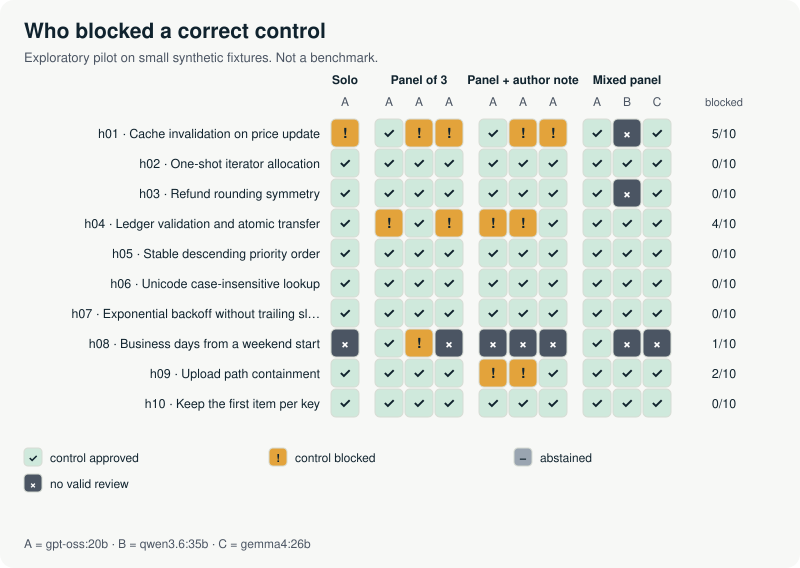

# Pilot B — corpus v2, 10 November 2026

**Result: no missed bug, but shared false alarms.** On ten harder paired changes, the same
three local models again identified every planted defect: 100 of 100 faulty-candidate
reviews blocked with the right finding, in every protocol. The failures appeared on the
correct versions instead. One model invented the same unwritten requirement in independent
samples, so any-block panels rejected more correct code than a single reviewer did.



| Protocol | Faulty approved | Defect identified | Controls blocked (bounds) | Output tokens |
| --- | --- | --- | --- | --- |
| Solo (A) | 0/10 | 10/10 | 1/10 (10–20%) | 38,334 |
| Panel of 3 (A×3) | 0/10 | 10/10 | 3/10 (30%) | 113,483 |
| Panel + author note (A×3) | 0/10 | 10/10 | 3/10 (30–40%) | 114,001 |
| Mixed panel (A, B, C) | 0/10 | 10/10 | 0/10 (0–30%) | 198,198 |

A = gpt-oss:20b, B = qwen3.6:35b, C = gemma4:26b, same transport and settings as pilot A.
Bounds count each truncated review first as an approval, then as a block; they are not
confidence intervals. With ten control candidates per arm, these are counts to inspect,
not rates to generalize.

## What happened on correct code

All 12 blocked controls came from model A (12 of its 75 valid control reviews). Models B
and C blocked none of their valid control reviews. Each block was triaged in its judgment:

| Control | Blocks | What the reviewers claimed | Triage |
| --- | --- | --- | --- |
| h01 cache | 4 | The constructor must reject negative prices | Specification ambiguity: the contract describes the prices, it does not ask for validation |
| h01 cache | 1 | Repeated lookups of an unknown SKU count as two reads | Specification ambiguity under a literal reading |
| h04 transfer | 4 | Non-integer amounts must raise ValueError | False alarm: the ValueError cases are listed and include no type check |
| h09 upload path | 2 | Base "/" is mishandled | False alarm: the contract excludes a trailing slash, so "/" is outside the domain |
| h08 business days | 1 | Saturday plus 5 business days is wrong | False alarm: the reviewer's expected date is miscomputed |

The same invented rule recurred across independent requests at temperature 1: four
samples asked for constructor validation on h01 and four for an integer type check on h04
(a fifth raised it as an extra finding on the faulty h04). Under any-block aggregation one
such sample is enough to reject the change, so a panel of three samples rejected 3 of 10
correct candidates where the solo reviewer rejected 1, for three times the output tokens.

Correct code was also more expensive to review. Model A's median output was 1,912 tokens
on controls against 1,125 on faulty candidates, and all 9 answers cut at the 8,192-token
cap were on controls (6 on h08, across all three models). Truncations are recorded as
`invalid_output`, never retried, and widen the bounds above.

## Correct verdict, flawed evidence

18 of the 100 correct detections carried a flawed worked example, a wrong weekday or an
extra invalid finding. 8 of the 10 h08 detections gave the wrong weekday for their own
example date while still naming the right mechanism. The judgments count a detection
when the finding names the planted mechanism and the violated rule; each flaw is quoted
in its rationale in [adjudications.jsonl](adjudications.jsonl). This is why the harness keeps
"blocked", "identified the defect" and "gave valid evidence" apart.

## Limits

The corpus author is also the judge: Claude Opus 5.5, the repository's engineering agent,
an LLM that knew the targets (method `external_judge`). No human has audited these judgments
yet, and no independent reviewer checked the cases before use. Two contract sentences
(h01) proved ambiguous; that is a corpus finding, kept rather than repaired after the
fact. Ten small synthetic families, three mid-size open models, one machine. Nothing here
ranks models or generalizes to production code review.

## Reproduce

```bash
python tools/reproduce_reports.py
python tools/analyze_run.py --run results/pilot-2026-11-10-v2/run
```

Plan frozen before the first request: [PILOT_2026-11-B.md](../../research/PILOT_2026-11-B.md).
Corpus: [fixtures-v2](../../fixtures-v2/). Faulty-candidate map: [blindspot-map-faulty.svg](blindspot-map-faulty.svg).
Reviewer-level descriptives: [reviewer-descriptives.json](reviewer-descriptives.json).
