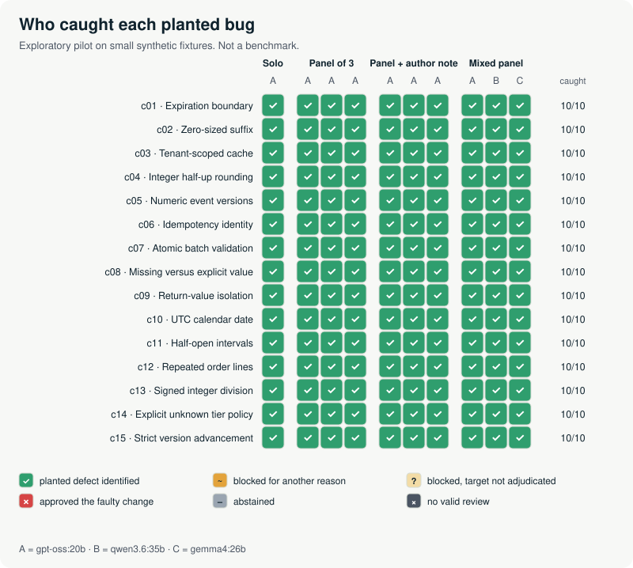

# Pilot A — corpus v1, 10 November 2026

**Result: a ceiling.** Three open-weight models, run locally, reviewed 15 paired Python
changes in four protocols (300 reviews). Every faulty candidate was blocked with a finding
that identifies the planted defect, and every correct control was approved, in every arm.
On this corpus there was no blind spot to share, so panels could not improve on a solo
reviewer; they only cost three times the tokens.



| Protocol | Reviews | Faulty approved | Defect identified | Controls blocked | Output tokens | Summed latency |
| --- | --- | --- | --- | --- | --- | --- |
| Solo (A) | 30 | 0/15 | 15/15 | 0/15 | 19,856 | 24 min |
| Panel of 3 (A×3) | 90 | 0/15 | 15/15 | 0/15 | 55,094 | 73 min |
| Panel + author note (A×3) | 90 | 0/15 | 15/15 | 0/15 | 53,750 | 64 min |
| Mixed panel (A, B, C) | 90 | 0/15 | 15/15 | 0/15 | 153,125 | 163 min |

A = gpt-oss:20b, B = qwen3.6:35b, C = gemma4:26b, through Ollama 0.40.14 on one AMD Ryzen AI
Max+ 395 machine. Output tokens include thinking. Latency is summed per request with up to
three concurrent requests; it measures load on this machine, not wall time of a panel.
All three paired comparisons have a delta of exactly 0 on 15 families. Joint-miss rates are
0 for every pair of slots. Technical failures: 0 of 300. Abstentions: 0.

## What this does and does not show

It shows that single-function defects with a complete written contract are easy for
current mid-size open models: even the 20B model never missed. It also shows the harness
end to end on real outputs: frozen plan, one stateless request per job, schema-checked
answers (300/300 parsed directly), anonymized judging, bounded metrics and recomputable
reports. It does not show that panels are useless, that these models review real code
well, or anything about larger or hosted models. A ceiling cannot discriminate protocols.
The follow-up is [pilot B](../pilot-2026-11-10-v2/README.md) on a harder corpus.

## Judging

All 150 blocking reviews were on faulty candidates. Each was judged from an anonymized
grading packet against the rubric in [ADJUDICATION.md](../../research/ADJUDICATION.md). The judge
was Claude Opus 5.5, the engineering agent that maintains this repository: an LLM, not a
person, which designed the pilot and knew the targets (method `external_judge`). All 150 were
judged `detected`; one review also contained an invalid extra finding (rejecting naive
datetimes that the contract leaves out of scope), recorded in its rationale and not counted.
Every judgment and its rationale is in [adjudications.jsonl](adjudications.jsonl). An
independent human audit of a sample is the declared next step.

## Reproduce

```bash
python -m rbs report --run results/pilot-2026-11-10/run --out ../pilot-a-recomputed
python tools/analyze_run.py --run results/pilot-2026-11-10/run
python tools/render_blindspot_map.py --run results/pilot-2026-11-10/run --out ../map.svg
```

No model is needed: the run keeps every request, raw response and hash. `run/transport/`
holds the frozen model digests and one folder per attempt; `run/report/` has metrics, the
per-candidate CSV and the provenance of the computing code. To rerun the reviews, prepare a
new run from `configs/pilot-local.json` and send it through `configs/transport.ollama-pilot.json`
with the same model tags; sampling at temperature 1 will not give byte-identical answers.

Plan frozen before the first request: [PILOT_2026-11.md](../../research/PILOT_2026-11.md) (also
copied in `run/frozen/research/`). Reviewer-level descriptives: [reviewer-descriptives.json](reviewer-descriptives.json).
Controls map: [blindspot-map-controls.svg](blindspot-map-controls.svg).
